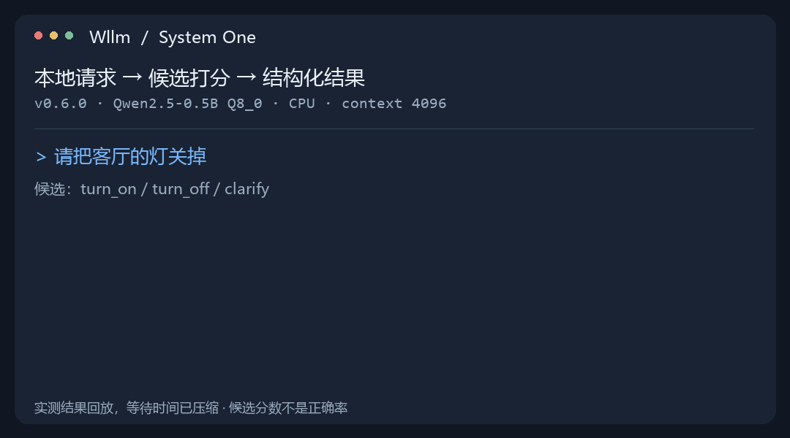

# Wllm

<div align="center">

**无需训练，让 Windows 上的本地模型直接做分类和动作选择。**

给出请求和候选，System One 直接返回选择与候选分数，省去回答文本生成。

C++ · llama.cpp / ggml · CPU AVX2 · Windows x64

[](https://github.com/LuckyStar2456/Wllm/releases/latest)
[](https://github.com/LuckyStar2456/Wllm/actions/workflows/windows.yml)
[](LICENSE)
[](bucket/wllm.json)

[看效果](#看看-system-one-怎么用) · [首次运行](#快速开始) · [接入应用](#http-服务) · [使用文档](#文档) · [下载](https://github.com/LuckyStar2456/Wllm/releases/latest)

</div>

## 看看 System One 怎么用

例如，你正在给应用添加一个灯光动作选择器：应用提供 `turn_on`、`turn_off`、`clarify` 三个选项，模型根据用户请求返回选项和分数。



这是已发布 **v0.6.0、Qwen2.5-0.5B Q8_0、CPU、4096 上下文**的关灯样例实测回放，等待时间经过压缩。数值、配置与同轮三条样例的原始选择见[演示数据](assets/system-one-demo.json)，其中其他请求出现了误判；这里展示接口用法，不作为准确率或加速比评测。

**你负责定义选项，Wllm 返回结果，应用决定如何执行。** 同一种接口也可用于意图分类、任务路由、条件判断和分级评分；Wllm 本身不会执行开灯等外部动作。

| 需要的结果 | System One 的输出 |
|---|---|
| 从候选动作中选一个 | `choice`：选项 ID、候选分数与 `confidence` |
| 判断一个条件是否成立 | `noul`：该条件为真的相对分数 |
| 按给定等级评分 | `score`：等级分布与期望分数 |

候选分数表示当前候选集合内的相对偏好，`confidence` 也不是经过业务校准的正确率。模型选择、提示和选项描述都会影响判断，应使用实际任务样本验证。

## 快速开始

需要 **Windows x64 / AVX2 CPU**。以下在 PowerShell 中运行；先通过已安装的 [Scoop](https://scoop.sh/) 获取程序：

```powershell
scoop bucket add wllm https://github.com/LuckyStar2456/Wllm
scoop install wllm/wllm
```

没有 Scoop 可用[Windows 发布包](https://github.com/LuckyStar2456/Wllm/releases/latest)：解压并进入程序目录，把后续命令中的 `wllm` 换成 `.\wllm.exe`。Scoop 安装后若找不到命令，重新打开终端。

### 1. 下载一个已验证的小模型

首次可选官方 [Qwen2.5-0.5B-Instruct-GGUF](https://huggingface.co/Qwen/Qwen2.5-0.5B-Instruct-GGUF)，文件为 **`qwen2.5-0.5b-instruct-q8_0.gguf`**（约 644 MiB）。下面固定下载版本，在当前目录创建 `models` 文件夹：

```powershell
New-Item -ItemType Directory -Force .\models | Out-Null
$modelUrl = 'https://huggingface.co/Qwen/Qwen2.5-0.5B-Instruct-GGUF/resolve/9217f5db79a29953eb74d5343926648285ec7e67/qwen2.5-0.5b-instruct-q8_0.gguf'
curl.exe --fail --location $modelUrl --output .\models\qwen2.5-0.5b-instruct-q8_0.gguf
```

下载需要网络，模型准备好后推理在本机执行。这个小模型适合先跑通接口；本机动作选择样例中也出现过误判，不能据此直接接管业务。其他已验证模型见[模型接入说明](guides/models.md#实测文件)。

### 2. 定义请求与候选

复制下面整段命令，将请求保存为 UTF-8 的 `request.json`：

```powershell
@'
{
  "state": {"user_request": "请把客厅的灯关掉"},
  "questions": {
    "action": {
      "type": "choice",
      "instructions": "根据用户请求选择动作。请求开灯选择 turn_on，请求关灯选择 turn_off，其他请求选择 clarify。",
      "criteria": {
        "turn_on": "打开灯",
        "turn_off": "关闭灯",
        "clarify": "询问用户以澄清需求"
      }
    }
  }
}
'@ | Set-Content -Encoding UTF8 .\request.json
```

### 3. 运行并读取选择、分数与耗时

```powershell
$result = wllm --model .\models\qwen2.5-0.5b-instruct-q8_0.gguf --context 4096 --mode system_one --request-file .\request.json --quiet-metrics | ConvertFrom-Json
$result.answers.action | ConvertTo-Json -Depth 4
'请求耗时：{0:N3} 秒；生成回答 token：{1}' -f $result._wllm.elapsed_s, $result.usage.output_tokens
```

结果包含 `choice`、各选项的 `probabilities` 和 `confidence`。候选打分不生成回答文本，因此 `usage.output_tokens` 为 **0**；输入处理仍然需要计算，最终延迟取决于模型、输入和硬件。

修改 `request.json` 的 `state.user_request` 后再次运行，即可测试自己的请求。更多三类题型见[System One 使用说明](guides/systemone.md)和[通用请求示例](configs/system-one.example.json)。

<details>
<summary>模型下载校验、更新与其他安装方式</summary>

上述模型文件 SHA256：`ca59ca7f13d0e15a8cfa77bd17e65d24f6844b554a7b6c12e07a5f89ff76844e`。

```powershell
Get-FileHash .\models\qwen2.5-0.5b-instruct-q8_0.gguf -Algorithm SHA256
scoop update wllm
```

直接安装自建 Scoop 清单：`scoop install https://raw.githubusercontent.com/LuckyStar2456/Wllm/main/bucket/wllm.json`。卸载用 `scoop uninstall wllm`；发布包不自动修改 PATH。源码构建见[下文](#从源码构建)。

</details>

## 功能

Wllm 将本地文本生成与 **System One 候选决策**放在同一个推理引擎上，提供交互终端和可供脚本调用的 CLI。

| 能力 | 使用体验 |
|---|---|
| 纯终端交互 | 蓝色实心字符横幅、原生滚动、中文编辑、多行粘贴、进程内输入历史 |
| 本地文本生成 | 流式输出、system 提示词、思考开关、上下文与采样设置 |
| System One 候选决策 | 接收业务选项，返回选择、候选相对分数和 confidence；支持 choice、noul、score |
| 通用模型入口 | 由 GGUF 元数据识别架构、词表、精度、分片和原生聊天模板；本地选择、加载/释放与权重复用 |
| 架构契约 | 从逐层几何与张量布局描述 Dense、MoE、注意力及混合状态；推理/代码任务共用底层架构 |
| 文本与模板 | 指令模型使用自带模板；基础模型使用 `--raw` 补全；支持显式 Jinja 模板覆盖 |
| 过程与结果 | 加载/输入处理状态、首 token 或决策耗时、生成速率、token 数与内存摘要 |
| 执行控制 | 取消、超时、错误后继续操作、显式导出结果 |
| HTTP 服务 | 按 `openai`、`systemone`、`all` 开放接口，指定地址/端口，支持 SSE 与可选 Bearer 认证 |
| CLI 集成 | 文本或 JSON 输出、文件输入、stdout/stderr 分离、明确退出码 |

CPU 发行包面向 **Windows x64 / AVX2**，使用者自行提供模型文件。默认上下文 **16384**、思考开启，注意力 KV 为 F16，其他状态由模型架构决定；参数通过显式设置调整。模型按文件自带精度执行，使用原生词表和模板；思考开关是否生效由所选模型模板决定。详见[模型接入说明](guides/models.md)。

## 两种使用方式

**交互终端**适合直接提问、切换模式、查看状态：

```text
/load
/system 请用简洁的中文回答。
请解释什么是质数。
/metrics
/export result.json
/unload
```

**CLI** 适合脚本调用，生成文本写入 stdout，指标与错误写入 stderr：

```powershell
wllm --model "D:\Models\model.gguf" --prompt "用中文解释质数。"
wllm --model "D:\Models\model.gguf" --prompt-file prompt.txt --max-tokens 128
```

## HTTP 服务

把同一份请求接入应用。先在一个终端启动本地服务，权重在请求之间常驻：

```powershell
wllm --serve --service systemone --host 127.0.0.1 --port 8080 --model .\models\qwen2.5-0.5b-instruct-q8_0.gguf --context 4096
```

在另一个终端进入 `request.json` 所在目录，发送刚才的请求：

```powershell
$response = Invoke-RestMethod -Uri 'http://127.0.0.1:8080/v1/systemone' -Method Post -ContentType 'application/json; charset=utf-8' -Body ([IO.File]::ReadAllBytes((Join-Path $PWD 'request.json')))
$response.answers.action | ConvertTo-Json -Depth 4
```

`--service all` 同时开放文本生成与决策；通用文本客户端使用 Base URL `http://127.0.0.1:8080/v1` 和模型名 `wllm-local`。支持的 OpenAI 兼容字段、SSE、认证与错误处理见[服务说明](guides/service.md)。`Ctrl+C` 停止服务并释放模型。

## 性能与判断质量

System One 的确定性变化是**省去回答文本生成，直接读取候选分数并返回结构化结果**。与“让模型生成一个动作名，再解析文本”的方案相比，实际节省多少时间、是否保持判断质量，需要在同模型、同任务上测量；目前没有可公开复现的配对基准，因此不公布加速倍数或业务正确率。

衡量自己的场景时，固定模型文件与候选、任务集、上下文和线程配置；分别记录冷启动与常驻请求的端到端延迟、峰值内存、正确/错误数，并保留无法判断的样本。模型能力、候选集合和描述改变后重新评估。下面的测试范围说明执行与接口验证，不能替代业务质量评测。

## 默认无状态

- **配置与记录按需启用**：默认不写日志、配置或输入历史，不自动读取本机配置；`--config FILE` 显式加载配置。
- **每次请求上下文独立**：连续请求复用已加载权重，历史输入不自动加入下一次模型输入。
- **保存由使用者决定**：`/export FILE` 导出上次结果，`--record FILE` 记录指标；界面参数修改只在当前进程生效。
- **交付内容明确**：发布包包含程序、通用示例、使用文档、品牌资源、许可证和校验清单；模型文件另行准备。

## 测试配置

本版在 **Windows 11 x64 · Intel Core i5-1135G7 · 16GB RAM · CPU AVX2** 配置上测试。

| 实测模型 | 文件大小 | 精度 | 上下文配置 |
|---|---:|---|---:|
| Qwen3.5-9B 文本 GGUF | 5.15 GiB | Q4_K_M | 16384 |
| Qwen2.5-0.5B-Instruct | 644.41 MiB | Q8_0 | 4096 |
| SmolLM2-135M-Instruct（Llama 架构） | 100.57 / 258.34 MiB | Q4_K_M / F16 | 4096 |

| 范围 | 完成检查 |
|---|---|
| 原生组件 | 124 项配置、计量、候选打分、System One 映射、架构策略与 Unicode 输出检查 |
| 架构结构 | 随机权重微型 GGUF 实际执行 MHA/MQA/GQA、MoE/共享专家、MLA 和滑动注意力；核对 logits、请求隔离、专家算子和 HTTP，语言模型实测单列 |
| CLI | 空目录启动、默认无状态文件、显式配置/记录、Unicode 路径、JSON 与重定向 |
| 终端 | Windows ConPTY、PowerShell/CMD；38/48/80/100 列，横幅、编辑、粘贴、历史、缩放与退出恢复 |
| 真实模型 | 跨架构与精度的文本生成、System One 三类题型、权重复用、独立请求；Qwen3.5 的取消恢复与结果导出 |
| 模板与补全 | 模型原生模板、模板缺失提示、显式 Jinja 覆盖与原始文本补全 |
| HTTP 服务 | SmolLM2 Q4_K_M、Qwen2.5 Q8_0：JSON/SSE、三类决策题型、认证、端口冲突、请求隔离、断线/超时恢复与 Ctrl+C 停止；OpenAI Python 2.41.0 客户端对接 |
| 分发安装 | Scoop 下载、SHA256 校验、解压、命令入口，以及发布包解压启动 |

v0.5.0 的 Qwen3.5-9B 同配置 CLI/HTTP 固定种子对照中，11 个输入 token、8 个输出 token 与原版本一致。

本轮还完成该 9B / 16K 基线的模板、输入 token、采样和状态配置对照；架构结构检查与真实模型运行记录分别列示。

## 从源码构建

准备 Git、Visual Studio 2022 C++ 桌面开发工具和 CMake 3.24+：

```powershell
git clone https://github.com/LuckyStar2456/Wllm.git
cd Wllm
.\scripts\build.ps1 -BuildDirectory build/public
.\build\public\bin\Release\wllm.exe --tui
```

构建脚本获取固定版本的源码依赖，构建并运行原生检查。模型单独准备。

## 文档

| 面向使用者 | 面向开发者 |
|---|---|
| [Windows 使用说明](guides/windows.md) · [HTTP 服务](guides/service.md) | [构建、测试与贡献](CONTRIBUTING.md) |
| [模型接入说明](guides/models.md) · [System One 决策](guides/systemone.md) | [依赖版本](dependencies.json) · [第三方声明](THIRD_PARTY_NOTICES.md) |
| [默认配置](configs/default.json) · [候选示例](configs/light-switch.candidates.json) | [更新记录](CHANGELOG.md) · [问题反馈](https://github.com/LuckyStar2456/Wllm/issues) |

## 开源与致谢

Wllm 使用 [MIT](LICENSE) 许可证，模型遵循各自许可证。

- [llama.cpp / ggml](https://github.com/ggml-org/llama.cpp)：本地推理引擎与张量计算基础。
- [nlohmann/json](https://github.com/nlohmann/json)：JSON 解析与序列化。
- [OpenCode](https://opencode.ai/docs/tui/) / [Ollama](https://github.com/ollama/ollama)：终端命令与用户文档组织参考；启动横幅呈现参考 Spring Boot。
